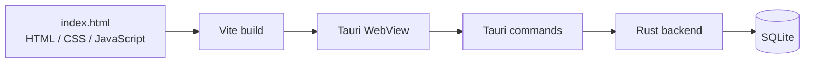

<p align="center"></p>
<h1 align="center">Campus Job Tracker</h1>
<p align="center"><strong>Keep campus roles, application progress, interview reviews, and resumes together.</strong></p>
<p align="center">Tauri 2 · Rust · SQLite · Windows</p>
<p align="center">
  <a href="https://github.com/ZARADEE/Campus-Recruitment-Progress-Record/tree/v0.1.0"></a>
  <a href="https://github.com/ZARADEE/Campus-Recruitment-Progress-Record/actions/workflows/ci.yml"></a>
  
  
</p>
<p align="center"><a href="README.md">简体中文</a> · <strong>English</strong></p>

A local-first Windows desktop app for capturing job openings, tracking applications, reviewing interviews, and maintaining role-specific resumes. Job and resume data stay on this device.

## What it does

- Import roles from Markdown, Word `.docx`, or CSV. Review and edit CSV rows before saving.
- Preview details from public recruiting pages and confirm the extracted job information.
- Track publication, entry, and recent activity dates; view saved descriptions and source URLs.
- Group roles by company and follow applications through assessment, interviews, offers, and onboarding.
- Organize first, second, third, and HR interview questions, answers, outcomes, and notes.
- Edit role-specific resumes and export them to Word or PDF.
- Confirm before deleting a role and its associated progress and interview records.

## Architecture



`index.html` is the production desktop UI source, not a separate prototype. Vite builds it and its assets into `dist/`; Tauri loads those files in its WebView. The frontend handles presentation and interaction. Rust commands in `src-tauri/src/` handle SQLite, file parsing, public-page requests, and resume export. `npm run dev` is a browser preview with sample data; the desktop app uses Tauri IPC and persists data in SQLite.

## Build on Windows

Install dependencies and build the desktop app:

```powershell
npm ci
npm run desktop:test
npm run desktop:build
```

For desktop development, run `npm run desktop:dev`. Building requires Node.js, the stable Rust MSVC toolchain, Microsoft C++ Build Tools, the Windows SDK, and WebView2 Runtime. The optimized executable is written to `src-tauri/target/release/campus-job-tracker.exe`.

The browser preview can be started with `npm run dev`; file import, page fetching, SQLite persistence, and resume export require the desktop app.

## CSV format

The first row must contain column names; company and role are required. See [the CSV template](examples/岗位导入模板.csv). UTF-8 (with BOM) and GB18030 are supported. Dates use `YYYY-MM-DD`; leave the publication date blank when the official page does not provide one. A batch can contain up to 1,000 rows and 20 MiB. Rows are reviewed before saving; the desktop importer does not merge duplicates automatically.

## Local data

The database, original resume documents, and imported files live in `data/` or Tauri's standard user data directory. `.gitignore` excludes local data, SQLite files, toolchains, caches, and build outputs. The public repository does not contain personal application records or resumes. The app only requests public HTTP/HTTPS pages after the user initiates a fetch; it does not bypass login or CAPTCHA controls.

Read [product scope](PRODUCT.md), [technical design](TECHNICAL_DESIGN.md), [implementation notes](IMPLEMENTATION.md), and the [changelog](CHANGELOG.md). See [CONTRIBUTING.md](CONTRIBUTING.md) before opening a pull request and use the issue templates for [bugs](https://github.com/ZARADEE/Campus-Recruitment-Progress-Record/issues/new?template=bug_report.yml) or [feature requests](https://github.com/ZARADEE/Campus-Recruitment-Progress-Record/issues/new?template=feature_request.yml).
