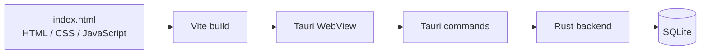

<p align="center"></p>
<h1 align="center">求职进度台</h1>
<p align="center"><strong>把校招岗位、投递进度、面试复盘和简历整理在一处。</strong></p>
<p align="center">Tauri 2 · Rust · SQLite · Windows</p>
<p align="center">
  <a href="https://github.com/ZARADEE/Campus-Recruitment-Progress-Record/tree/v0.1.0"></a>
  <a href="https://github.com/ZARADEE/Campus-Recruitment-Progress-Record/actions/workflows/ci.yml"></a>
  
  
</p>
<p align="center"><strong>简体中文</strong> · <a href="README.en.md">English</a></p>

一款本地优先的 Windows 桌面应用，用来收集招聘岗位、跟进投递流程、整理面试问答和维护岗位简历。岗位数据库与简历文件保存在本机。

## 适用场景

| 需要处理的事情 | 应用中的入口 |
| --- | --- |
| 先收集岗位，之后再决定是否投递 | 「看看机会」 |
| 持续跟进投递和招聘阶段 | 「正在推进」 |
| 按公司、岗位和轮次回看面试问题 | 「面试记录」 |
| 为不同岗位准备和导出简历 | 「个人简历」 |

## 功能

- 从 Markdown、Word `.docx` 或 CSV 导入岗位；CSV 保存前可逐条检查和编辑。
- 抓取公开招聘网页中的 JD 候选信息，确认后再保存。
- 查看 JD 正文和来源网址；记录岗位发布时间、录入时间及最近活动。
- 将岗位按公司归组，并跟踪投递、测评、笔试、面试、Offer 到入职阶段。
- 为一面、二面、三面和 HR 面记录题目、回答、结果与复盘。
- 导入并编辑岗位简历，导出 Word，或通过系统打印窗口保存为 PDF。
- 删除岗位前二次确认，并清理关联的阶段事件和面试记录。

## 技术结构



`index.html` 是正式桌面应用的界面源码，不是独立原型。Vite 将它和相关前端资源构建到 `dist/`，Tauri 窗口通过 WebView 加载这些资源。前端负责显示和交互，岗位读写、文件解析、网页请求与简历导出由 `src-tauri/src/` 中的 Rust 命令处理。`npm run dev` 提供使用样例数据的浏览器预览；桌面版通过 Tauri IPC 调用 Rust 并持久化到 SQLite。

## 构建与运行

从仓库克隆后，在 Windows 上安装依赖并构建桌面应用：

```powershell
npm ci
npm run desktop:test
npm run desktop:build
```

开发桌面端：

```powershell
npm run desktop:dev
```

构建需要 Node.js、Rust 稳定版 MSVC 工具链、Microsoft C++ Build Tools、Windows SDK 和 WebView2 Runtime。优化版可执行文件位于 `src-tauri/target/release/campus-job-tracker.exe`。运行仓库根目录的 `启动求职进度台.cmd` 时，应用数据和 WebView 缓存位于项目 `data/` 目录。

浏览器预览可使用 `npm run dev`；文件导入、网页抓取、SQLite 保存和简历导出需要桌面版。

## 岗位 CSV

首行为列名，至少包含公司和岗位名称。模板见 [examples/岗位导入模板.csv](examples/岗位导入模板.csv)。支持 UTF-8（含 BOM）和 GB18030；日期为 `YYYY-MM-DD`，缺少明确官方发布时间时留空。单次最多 1000 行，文件不超过 20 MiB。CSV 内容进入可编辑预览后再保存，桌面导入流程不会自动合并重复岗位。

| 字段 | 支持的列名示例 |
| --- | --- |
| 公司 | 公司、公司名称、企业、`company`、`company_name` |
| 岗位 | 岗位、岗位名称、职位、`title`、`role`、`job_title` |
| 城市 | 城市、地点、工作地点、`city`、`location` |
| 发布时间 | 发布时间、发布日期、`published_at`、`datePosted` |
| 岗位描述 | JD、岗位描述、职位描述、`description`、`jd_text` |
| 网址 | 网址、招聘网址、链接、`url`、`source_url` |

## 本地数据

岗位数据库、简历原件及导入文件保存在本机 `data/` 目录，或 Tauri 标准用户数据目录。`.gitignore` 排除 `data/`、SQLite 文件、工具链、缓存和构建产物，不会将本机求职记录或简历加入源码提交。网页抓取只在用户主动触发时请求公开 HTTP/HTTPS 页面，不绕过登录或验证码。

备份数据前请先关闭应用，再复制 `data/` 目录。浏览器预览使用样例数据，不连接本机 SQLite。

## 项目文档

- [产品范围](PRODUCT.md) · [技术方案](TECHNICAL_DESIGN.md) · [实现说明](IMPLEMENTATION.md)
- [界面设计方向](UI_DIRECTION.md) · [验证记录](VALIDATION.md) · [版本变更](CHANGELOG.md)
- [参与贡献](CONTRIBUTING.md) · [安全问题](SECURITY.md) · [行为准则](CODE_OF_CONDUCT.md)

提交问题前请搜索已有 Issue。使用 [缺陷报告](https://github.com/ZARADEE/Campus-Recruitment-Progress-Record/issues/new?template=bug_report.yml) 或 [功能建议](https://github.com/ZARADEE/Campus-Recruitment-Progress-Record/issues/new?template=feature_request.yml) 模板。
