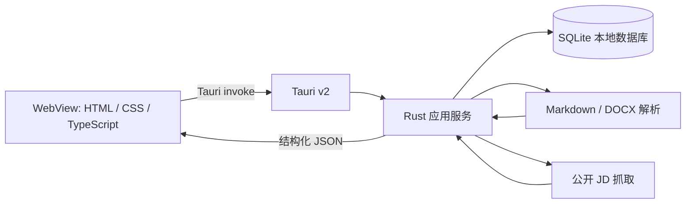

# 招聘进度与面试复盘工具技术方案

版本：0.2（桌面版实现）

本方案定义 Tauri 桌面端的数据语义、接口边界和验收标准。仓库已接入 Rust、SQLite、文件导入和公开 JD 抓取。下面保留整体规划，具体已实现命令、CSV 扩展及后续范围见 [IMPLEMENTATION.md](IMPLEMENTATION.md)。

## 产品范围

- **看看机会**：管理尚未投递的岗位；从 `.md` / `.docx` / `.csv` 导入或从招聘网址抓取；展示录入时间及 JD 明确给出的发布时间。
- **正在推进**：管理已投递岗位；记录招聘阶段与最近活动时间；每个面试节点可打开对应复盘。
- **面试记录**：按公司、岗位、面试轮次归档问题与回答，支持增改、排序和回看。
- **知识积累**：按分类保存独立的个人文档，与岗位面试问答分开存储。

阶段节点建议为投递、测评、笔试、AI 面试、简历筛选、面试、Offer、入职。四种面试轮次为一面、二面、三面、HR 面。阶段表示整体招聘流程位置；一次实际面试则保存为独立面试记录。

## 技术架构

正式应用建议采用 Tauri v2、Rust 稳定版、Vite + TypeScript、SQLite。前端负责界面、表单校验、编辑状态和调用命令；Rust 负责文件读取、网页请求、解析、数据库事务及备份。WebView 不直接读取任意本地路径，也不直接访问用户粘贴的网址。数据库放在 Tauri `app_data_dir` 下；数据库访问集中在 Rust repository 层。耗时操作通过异步命令执行，避免阻塞窗口线程。前后端通过可序列化的结构化命令参数和返回值通信。

## 数据模型

数据库时间戳用 UTC RFC 3339 表示，界面按系统本地时区显示。无法确定的日期存为 `NULL`，不补猜测值。

| 表 | 关键字段与用途 |
| --- | --- |
| `companies` | `id`, `name`, `normalized_name`, `created_at`；公司归一与归档入口 |
| `jobs` | `id`, `company_id`, `title`, `status`, `published_at`, `created_at`, `applied_at`, `last_activity_at`, `current_stage`, `source_url`, `source_kind`, `location`, `salary`, `employment_type`, `jd_text`, `updated_at` |
| `job_events` | `id`, `job_id`, `event_type`, `from_stage`, `to_stage`, `occurred_at`, `note`；追加式保存投递、阶段变化、Offer、关闭等历史 |
| `interview_sessions` | `id`, `job_id`, `round_type`, `round_index`, `interviewed_at`, `result`, `summary`, `created_at`, `updated_at`；一场具体面试一条记录 |
| `interview_questions` | `id`, `session_id`, `sort_order`, `question_text`, `answer_text`, `updated_at`；问题与回答分字段保存，允许空回答草稿 |
| `knowledge_documents` | `id`, `category`, `title`, `content`, `created_at`, `updated_at`；独立保存个人知识文档 |

`jobs.status` 使用 `opportunity`、`applied`、`closed`，其中 `closed` 表示流程已终止。终止只改变岗位状态并追加事件，不删除岗位、阶段或面试数据。`round_type` 使用 `first`、`second`、`third`、`hr`。外键和唯一约束维护归属关系。面试归档按 company → jobs → interview sessions 构造；知识目录按 category → documents 构造，二者彼此独立。

## 时间与状态规则

- 未投递岗位展示“录入于 `created_at`”和“发布于 `published_at`”。仅在文件或网页给出明确发布日期时才填写 `published_at`；缺失时显示空值。
- 点击“已投递”时，在一个事务中设置 `status=applied`、`applied_at`、初始 `last_activity_at` 并写入投递事件，岗位随即从机会列表移到正在推进列表。
- 阶段更新、面试记录保存、Offer 状态变化等有意义的用户操作会更新 `last_activity_at`。打开页面、搜索、筛选不改变此时间。
- 点击删除图标左侧的“终止”，确认后将岗位改为 `closed` 并显示“已拒绝”、刷新最近活动时间并写入事件；岗位仍能查看，流程节点不可再改。显式删除需要二次确认，并提示会级联删除关联的阶段事件和面试复盘。

### 岗位详情、知识积累和个人简历

机会列表用来源网址替代薪资展示；岗位详情在应用内显示已保存 JD，另提供打开官方页面的操作。机会与推进列表按公司连续排序。

简历原件保存在本地文件夹，编辑文本、目标岗位和显示名称存入 SQLite。Word 导出生成 DOCX；PDF 通过桌面 WebView 的打印对话框生成 A4 文件。

知识积累以独立的 `knowledge_documents` 表保存分类、标题和正文。正文使用带版本标识的 Tiptap JSON，原纯文本仍可读取；图片作为受限的 raster data URL 随文档持久化，单篇最多 24 MB。前端按 schema 渲染内容，过滤未知节点、不安全链接和远程图片。编辑器支持标题大纲、嵌套列表、待办、表格、代码、引用、图片缩放和专注写作，分类路径用 `/` 分层。自动保存按顺序执行，切换和关闭窗口前等待保存完成，不复用岗位或面试记录字段。

## 导入和 JD 抓取

### Markdown 与 Word

Markdown 读取 UTF-8，支持可选 YAML front matter（公司、岗位、城市、发布时间、网址）及正文标签。DOCX 只支持 `.docx`，不承诺旧 `.doc`；Rust 解析 ZIP 包中的 `word/document.xml`，读取段落与表格单元格后复用候选字段提取逻辑。两种格式均先进入可编辑预览，用户确认后才写入数据库。

建议限制原始文件 20 MiB、ZIP 展开总量 100 MiB，并限制条目数量与 XML 深度；拒绝损坏或超限文档。不运行宏、不打开嵌入对象。

### URL 抓取

只响应用户明确触发的 HTTP/HTTPS 公开招聘网页请求。抓取器提取标题、正文、发布日期、来源域名，结果先进入可编辑预览，不自动保存。首版支持无需登录的静态页面和稳定站点适配器。需要登录、脚本渲染、验证码或禁止自动抓取的页面，提示无法自动识别并提供粘贴 JD / 手动录入，不绕过访问控制。

Rust 端设置连接和总超时、响应体上限、有限跳转次数和每域限速。初始 URL、每次跳转及 DNS 解析结果均校验；拒绝 localhost、私有网段、链路本地、组播、保留地址和云元数据地址，避免请求内部网络。只接受网页协议，不允许把 URL 当成本地文件或代理地址。解析失败不改变已有数据。

## Tauri 命令边界

| 命令 | 用途 |
| --- | --- |
| `list_jobs(filter)` | 按区、公司、关键词、阶段或最近活动筛选 |
| `parse_job_file(path)` | 读取并返回 Markdown / DOCX 字段候选，不写库 |
| `preview_job_url(url)` | 安全抓取并返回待确认字段，不写库 |
| `create_job(draft)` | 校验并创建岗位草稿 |
| `mark_job_applied(job_id, applied_at)` | 原子迁移到正在推进并追加事件 |
| `update_job_stage(job_id, stage, occurred_at)` | 保存阶段与事件 |
| `terminate_job(job_id)` | 将已投递岗位标为终止并保留相关记录 |
| `list_interview_archive(filter)` | 查询公司、岗位、轮次归档 |
| `save_interview_session(session)` | 事务保存面试及问答，并更新时间 |
| `list_knowledge_documents()` / `create_knowledge_document(category, title)` | 查询或新建知识文档 |
| `save_knowledge_document(...)` / `delete_knowledge_document(id)` | 编辑或删除独立的知识文档 |
| `export_backup(path)` / `import_backup(path)` | 导出、校验和恢复版本化 JSON 备份 |

所有命令校验长度、枚举、日期和外键。错误转为稳定错误码及可本地化提示，不把敏感路径或响应原文直接返回界面。

## 安全、隐私与恢复

- 默认离线；只有用户点按抓取时才访问对应公开网址，不需要账户、云服务或后台进程。
- 使用 Tauri capability 将文件对话框等权限限制在主窗口；不开启宽泛的 shell、filesystem 或 HTTP 权限。
- SQL 使用参数化查询；JD 与回答按纯文本渲染，禁止将外部 HTML 插入 DOM。
- 文件对话框限制扩展名，Rust 再检查扩展、体积和实际内容。持久化路径由 Rust 依据 `app_data_dir` 构造，不接收前端任意写入路径。
- 备份使用带 `schema_version` 的 JSON；完整校验后以事务导入，出错保留原库。后续可加入轮换备份。
- 日志只记录命令类型、错误码、耗时，不记录 JD 全文、面试回答或 URL 查询参数。

## 验收标准

1. 有效 `.md` / `.docx` 可预览并修正候选字段后保存；未知发布时间保持为空。
2. 公开静态 URL 可生成待确认预览；不支持或不安全的 URL 明确失败且不写库。
3. 投递迁移同时记录投递时间和历史事件，列表分区正确。
4. 进度变化更新最近活动；纯查看操作不更新。
5. 四种轮次均能打开独立复盘；问题、回答可新增、修改、排序、保存。
6. 面试资料按公司、岗位、轮次查看，并在重启后保留。
7. 导入、抓取错误可恢复到手动录入，不损坏已有记录。

## 技术参考

- [Tauri v2: Calling Rust from the frontend](https://v2.tauri.app/develop/calling-rust/)
- [Tauri v2: Inter-process communication](https://v2.tauri.app/concept/inter-process-communication/)
- [Tauri v2: Dialog plugin](https://v2.tauri.app/plugin/dialog/)
- [Rust standard library: `Path::canonicalize`](https://doc.rust-lang.org/std/path/struct.Path.html#method.canonicalize)
